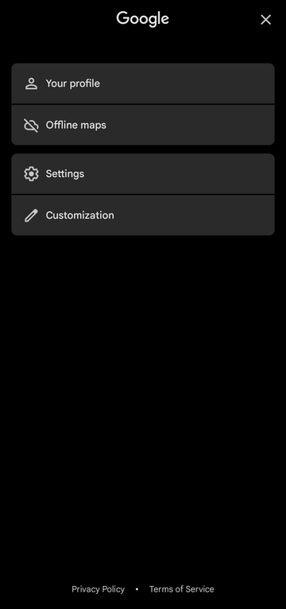
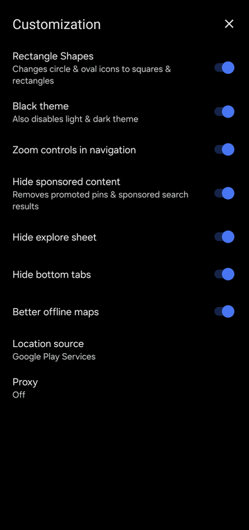
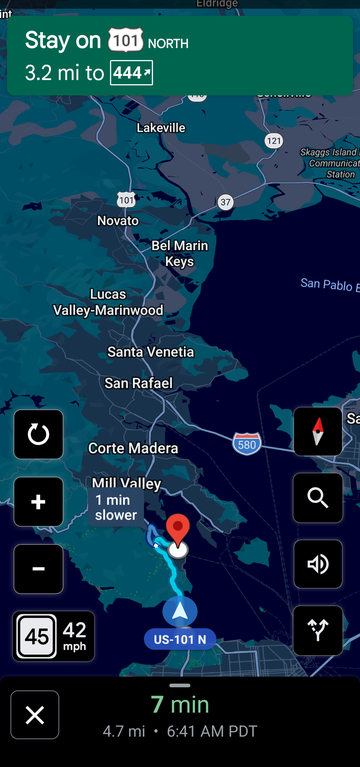

<h1> bearinmind patches</h1>

I'll continue to support patches for apps I use & apps that I get requests for (either for specific features or premium unlocking). Below is a short description of how to install my patches on morphe!

Install Morphe Manager if you have not yet: https://morphe.software

[Click here to add bearinmind patches to Morphe Manager](https://morphe.software/add-source?github=bearinmindcat/morphe-patches)

Select the app you want to patch inside Morphe Manager, follow all instructions shown.

## Patches

<!-- PATCHES_START -->
> **[v2.5.7](https://github.com/bearinmindcat/morphe-patches/releases/tag/v2.5.7)**&nbsp;&nbsp;•&nbsp;&nbsp;`main`&nbsp;&nbsp;•&nbsp;&nbsp;53 patches total

 Google Maps&nbsp;&nbsp;-&gt;&nbsp;&nbsp; Ungoogled Maps&nbsp;&nbsp;•&nbsp;&nbsp;28 patches

 

**Supported version(s):** 26.36.04.973607363

| Patch | Description | Options |
|----------|----------------|-----------|
| [120 refresh rate](#120-refresh-rate) | Lifts the 60 Hz limit Maps puts on itself, on the app and on the map, so it can run at your screen's full refresh rate (such as 120 Hz). Uses more battery, most of all while navigating. Off by default: switch it on on the Customization screen. |  |
| [Account sheet cleanup](#account-sheet-cleanup) | Removes the "More from this app" label from the account sheet, and keeps the sheet open when you come back from Settings or Customization or tap "Your profile", instead of dropping back to the map. |  |
| [Add microG support](#add-microg-support) | Builds microG Maps, a separate app (org.ungoogled.android.apps.maps.microg) that signs in to your Google account through microG: saved places and lists, Timeline, location sharing, contributions and push messages. Remove sign-in prompts, Trim account menu and Remove permissions are left out of this build, Offline saved places keeps only its Local saved screen, which copies your account's saved lists to the phone (Pull from Google account), and its icon carries microG's C. Needs microG: MicroG-RE or ReVanced GmsCore. Not for root (mount) installs. |  |
| [Any media app](#any-media-app) | Navigation's Default media app (Settings > Navigation) offers every music and podcast app that works with Android Auto, such as Poweramp, not only Spotify, YouTube Music and Pandora. |  |
| [Avoid Flock cameras](#avoid-flock-cameras) | Steers driving directions around Flock cameras: when Google's route passes one, a camera-free way is worked out with BRouter, an OpenStreetMap router, and Maps asks Google again for a route through it, so Google still times and navigates the trip, and keeps it through reroutes. A detour longer than half again the distance is dropped. Off until turned on in Waze & external data source, with Flock cameras; your route's start and end go to brouter.de. Trips with stops are left as they are. |  |
| [Better offline maps](#better-offline-maps) | Reworks the offline area picker: zooming out really selects more instead of being shrunk to Google's size cap, the box can be resized by dragging its edges and corners, a large area is split into several downloads whose true total size is shown, and areas already downloaded are drawn on the map. Can be turned off on the Customization screen. |  |
| [Black theme](#black-theme) | AMOLED-black theme. Pins Maps' own dark mode and its separate navigation colour scheme, and remaps colour resources, drawable fills and draw-time paints so no surface is left grey. |  |
| [Blue pin](#blue-pin) | Chromium-coloured flat map pin on every in-app product logo and the search bar's leading icon. |  |
| [Bypass Play Services checks](#bypass-play-services-checks) | Makes Maps' bundled Play services signature and availability checks always pass, so it runs re-signed and with Play services disabled or absent, and lets it load tiles, search and routing by sending Google's own package and certificate in the identity headers the Maps backend checks. Where Play services rejects the re-signed app, Maps degrades instead of crashing. |  |
| [Change app name](#change-app-name) | Sets the launcher and in-app app name. | • App name |
| [Change package name](#change-package-name) | Installs alongside stock Google Maps under its own package name. On by default, because stock Maps comes built into most phones and cannot be replaced by a patched copy. | • Package name |
| [Customization screen](#customization-screen) | Adds a Customization row under Settings on the account sheet, with switches for the patches here that can be turned back off inside the app. |  |
| [Flock cameras](#flock-cameras) | Puts Flock and other license plate reader cameras on the map, from OpenStreetMap -- the cameras DeFlock's volunteers map -- and chimes and shows a note when one is coming up ahead. Off until turned on in Waze & external data source, a row on the account sheet, because it downloads the ones near you from an OpenStreetMap server, over the same area as the speed cameras. |  |
| [Hide ads and clutter](#hide-ads-and-clutter) | Hides promoted map pins (on the map and along a route) and "Sponsored" search results, Gemini's AI summaries ("Know before you go" and the review summary), the row of businesses under an address on its place sheet, the home tab's Explore feed and the Explore / Contribute / You tabs. Each can be switched back on on the Customization screen. |  |
| [Legacy icon](#legacy-icon) | Uses the flat multicolour pin Maps had before the 2025 gradient icon as the launcher icon and on the screen Maps opens with. With Add microG support, microG's C sits in the pin's circle. |  |
| [Location provider toggle](#location-provider-toggle) | Adds a Location source choice to the Customization screen: Android's own location providers, microG's (microg Services) or Google Play services' fused provider. With Android, neither is ever asked for a location. A source that is missing or disabled is never used, so location keeps working without it. Also keeps the network (Wi-Fi/cell) provider registered when no fused provider answers, instead of GPS only, so a fix does not go stale indoors. | • Default to Play services location |
| [Offline saved places](#offline-saved-places) | Save places without a Google account, kept only on the phone: Save opens Maps' own "Place saved" sheet (Want to go, Travel plans, Starred places, Favorites, your own lists, a note), and a "Local saved" row on the account sheet rebuilds Maps' You tab -- your recent places, your lists and labels (Home, Work, your own) -- with export and import (backup file, KML, Google Takeout's saved lists and Saved Places.json, several files or the whole Takeout .zip at once). It also has a Timeline: where the phone has been, grouped into days and visits, kept only on the phone, with GPX export. Recording is off until switched on there; it shows a notification while it runs. With Add microG support, Maps' own Save keeps syncing to your account and Local saved instead copies the account's saved lists to the phone (Pull from Google account). |  |
| [Power saving mode](#power-saving-mode) | Brings the Pixel-only power saving mode to every phone: while driving with navigation, press the power button and Maps shows only key information such as the next turn on a black screen. Turn it on or off in Settings > Navigation > Power saving mode. Pixels that have it built in keep Google's own version unless Power saving mode is turned on in Power Saving Options, a row on the account sheet under Customization, which also has: a navigation button that opens the power saving screen without locking the phone, switching to it by itself when idle, a speedometer on it, a lower frame rate, and its black map in navigation or all over Maps. |  |
| [Proxy](#proxy) | Adds a Proxy screen to Customization that sends Maps' own traffic, map data included, through an HTTP proxy -- for example Orbot's (127.0.0.1:8118) to use Tor. Map data never falls back to a direct connection: if the proxy stops, Maps stops loading. Needs a recent Play services network engine (Cronet); Maps warns when it cannot take the proxy. |  |
| [Rectangle shapes](#rectangle-shapes) | Squares off rounded corners across the UI, including the two round navigation buttons. |  |
| [Remove permissions](#remove-permissions) | Removes permissions that only serve Google-account features or Google's data collection: background location, physical activity, contacts, microphone (voice search stops working), camera (Lens and Live View stop working), car speed, advertising ID, push messages and Google services settings. Left out with Add microG support, whose account features need them. |  |
| [Remove sign-in prompts](#remove-sign-in-prompts) | Removes Google's sign-in prompts: the first-launch "Make it your map" page, the search screen's "Tired of typing?" card and the account sheet's "Sign in" pill. Tapping "Your profile" (or the pill, where it still shows) answers with a "Can't sign in" toast instead of nothing. Left out with Add microG support, which signs in. |  |
| [Remove telemetry](#remove-telemetry) | Points the Firebase Installations and Play services compliance check-ins at an unresolvable host, stops every ad impression and click ping from being sent, and deregisters Google's logging, performance-monitoring, survey and Location History libraries and the on-device federated-learning services. With Add microG support, Firebase Installations and Location History are left alone, so Timeline, account sync and push messages keep working. |  |
| [Speed cameras](#speed-cameras) | Chimes and shows a note when a speed or red light camera is coming up ahead, and puts the cameras on the map, from OpenStreetMap. Off until turned on in Waze & external data source, a row on the account sheet, because it downloads the cameras near you from an OpenStreetMap server -- an area you choose there, about 25 to 175 km across. |  |
| [Speeding chime](#speeding-chime) | Plays a chime when your speed passes the speed limit during navigation, as Waze does. Maps itself only turns its speedometer red. When it chimes is chosen in Waze & external data source, a row on the account sheet. |  |
| [Trim account menu](#trim-account-menu) | Removes Your Timeline, Location sharing, Your data in Maps and Help & feedback from the account sheet. Left out with Add microG support, whose account features need them. |  |
| [Waze alerts](#waze-alerts) | Shows the alerts a Waze on the same phone is tracking -- police to begin with, and any of crashes, hazards, traffic jams, closures and speed cameras -- as pins on the map, with a chime and a note as one comes up ahead. Off until turned on in Waze & external data source. Waze has to be patched with Share alerts with Maps, signed in and open; in the background is enough. |  |
| [Zoom controls in navigation](#zoom-controls-in-navigation) | Adds +, − and reset tiles during turn-by-turn that change the navigation zoom while the camera keeps following the car. |  |

 AllTrails&nbsp;&nbsp;-&gt;&nbsp;&nbsp; AllTrails&nbsp;&nbsp;•&nbsp;&nbsp;8 patches

 

**Supported version(s):** 26.3.20

| Patch | Description | Options |
|----------|----------------|-----------|
| [2D / 3D compass](#2d-3d-compass) | Adds a 2D / 3D compass switch to the Experimental screen. With it on, tapping the compass in navigate mode switches the map between the tilted 3D view and a flat, north-up 2D map the way Google Maps' does, from any state (following you, panned away, paused), and brings the map back to you. The compass shows a single north arrow in 2D, and the next navigation starts in the mode you used last. |  |
| [Better filters](#better-filters) | Adds a Better filters switch to the Experimental screen. With it on, the trail filter's sliders move in finer steps over the same ranges: Rating in 0.1 stars (instead of Any, 3.5, 4 and 4.5), Length in 0.1 mi, Elevation gain in 10 ft, Highest point in 100 ft and Distance away in 1 mi (metric: 0.1 km, 5 m, 50 m, 1 km). |  |
| [Better tracking](#better-tracking) | Adds a Better tracking switch to the Experimental screen. With it on, recordings work the way Gaia GPS records: the phone's GPS directly with every fix delivered live (no Play services batching), fixes worse than 65 m or physically impossible dropped, points kept 3 m apart, no trail-biased smoothing, and elevation converted to sea level and counted in 2 m steps. |  |
| [Black icon](#black-icon) | Uses a white AllTrails logo on black for the launcher icon and the splash screen, instead of green on dark green, so this build is easy to tell apart from the stock app. |  |
| [Change package name](#change-package-name) | Installs alongside stock AllTrails under its own package name. | • Package name |
| [Experimental screen](#experimental-screen) | Adds an Experimental row to your profile's menu, under Edit profile and Share profile, that opens an Experimental screen. |  |
| [Remember filters](#remember-filters) | Adds a Remember filter states switch to the Experimental screen. With it on, the trail filters you set (length, elevation, rating, difficulty, activities, features and the rest, but not Distance away) stay set when you go back to the home screen and after the app restarts, instead of resetting. |  |
| [Theme](#theme) | Adds a Theme choice to the Experimental screen: Follow phone, Light, Dark or AMOLED black (dark with pure black backgrounds). AllTrails itself only follows the phone. |  |

 Waze&nbsp;&nbsp;-&gt;&nbsp;&nbsp; De-Waze&nbsp;&nbsp;•&nbsp;&nbsp;17 patches

 

**Supported version(s):** 5.24.5.0

| Patch | Description | Options |
|----------|----------------|-----------|
| [Alert distances](#alert-distances) | How far ahead, in metres, Waze warns of police, hazards, crashes, traffic jams and speed cameras. The defaults are the old Waze mods' (CGE); Waze's own are lower for most of them. They can be changed later in Customization, at the bottom of Waze's side menu. | • Police • Hazards • Crashes • Traffic jams • Speed cameras on streets • Speed cameras on highways • Speed cameras on freeways • Blocked lanes • Least distance between two alerts |
| [All moods](#all-moods) | Every mood can be chosen: the ones Waze keeps for higher ranks and the beta moods it hides. |  |
| [Bigger speedometer](#bigger-speedometer) | Bigger digits on the speedometer, and on the speed limit sign beside it, so they can be read at a glance. The sizes can be changed later in Customization, at the bottom of Waze's side menu, where a switch also gives Waze's own sizes back. | • Speed digits (dp) • Unit label (dp) • Speed limit sign digits (sp) • Speed limit sign digits, 100 and over (sp) |
| [Change app name](#change-app-name) | Sets the name shown under the launcher icon, in the app switcher and on Android Auto. | • App name |
| [Full black](#full-black) | Waze's dark mode in true black for AMOLED screens: the app's dark backgrounds are black, and with Black night map the night map's background too. Roads, labels, buttons and text keep their colours. | • Black night map |
| [Hide ads](#hide-ads) | Removes the sponsored pins on the map and on Android Auto, the full-screen ads shown while you are stopped, and the ad statistics Waze sends. |  |
| [Map skin](#map-skin) | The old Waze mods' map skin, as changes to Waze's own: bigger map labels, a wider navigation arrow head and a warm day background. It is applied as Waze starts, and can be switched off or changed later in Customization, at the bottom of Waze's side menu; changes show from Waze's next start. | • Map labels: huge • Map labels: big • Map labels: medium • Map labels: small • Navigation arrow head width • Day map background (hex) |
| [Navigation distances](#navigation-distances) | How far ahead Android Auto gives its heads-up, and how long a jam must last before the traffic bar shows it. The defaults are the old Waze mods' (Chuppito). They can be changed later in Customization, at the bottom of Waze's side menu. | • Android Auto heads-up, normal roads (m) • Android Auto heads-up, freeways (m) • Traffic bar: time in traffic (s) |
| [No AI reporting](#no-ai-reporting) | Turns off conversational reporting, Waze's Gemini voice assistant for reports, together with its activation dialog, tips and onboarding. |  |
| [No Google Assistant](#no-google-assistant) | Keeps Google Assistant out of Waze: no Assistant button, onboarding or settings entry, whatever Waze's server enables for your region. |  |
| [Open without device location](#open-without-device-location) | Waze opens with the phone's location switched off -- the map, search and planning work, and it picks up your position as soon as location is switched on -- instead of stopping at "To use Waze, turn on device location". Waze still needs the location permission. Can be switched off later in Customization, at the bottom of Waze's side menu. |  |
| [Report speed limit](#report-speed-limit) | Turns on Waze's own switch for correcting the speed limit from the speedometer, the old mods' "Report speed limit". Waze's server keeps it off; what it shows is not verified here. |  |
| [Share alerts with Maps](#share-alerts-with-maps) | Hands the alerts Waze is tracking -- police, crashes, hazards, traffic jams, closures and speed cameras -- to Ungoogled Maps on the same phone, where Waze alerts in Waze & external data source puts them on the map. Nothing leaves the phone. Waze has to be signed in and open; in the background is enough. |  |
| [Speed camera sound at any speed](#speed-camera-sound-at-any-speed) | Plays the speed camera sound for every camera, not only when you are over the speed limit. |  |
| [Speed cameras everywhere](#speed-cameras-everywhere) | Turns speed camera and police alerts back on in the countries where Waze's server switches them off. Warning of speed cameras is against the law in some of those countries. |  |
| [Speed limit sign](#speed-limit-sign) | The style of the speed limit sign beside the speedometer, whatever the country. It can be changed later in Customization, at the bottom of Waze's side menu. | • Sign style |
| [Stay awake in the background](#stay-awake-in-the-background) | Lets Waze keep running in the background without a route for the chosen time -- Waze's server allows 10 minutes -- so that its alerts keep reaching Maps while you navigate there. Costs battery; Waze still closes itself when you close it. The time can be changed later in Customization, at the bottom of Waze's side menu. | • Minutes in the background |

<!-- PATCHES_END -->

## Building

To build bearinmind patches, follow the [Morphe documentation](https://github.com/MorpheApp/morphe-documentation).

## Want more patches & features?

Open up an issue request and I'll do my best to fulfil your feature ideas for any specific apps you ask for, I enjoy working on random things so just ask!

## Misc info for myself
Always use Semantic commit (https://kapeli.com/cheat_sheets/Semantic_Commits.docset/Contents/Resources/Documents/index) messages. 
To keep it simple use only 3 commit message types:
feat: / fix: / chore:
Commits of fix: and feat: will automatically generate new pre-releases and chore: will not create a new release.

feat:/fix: make pre-releases on dev, and stable releases on main.

